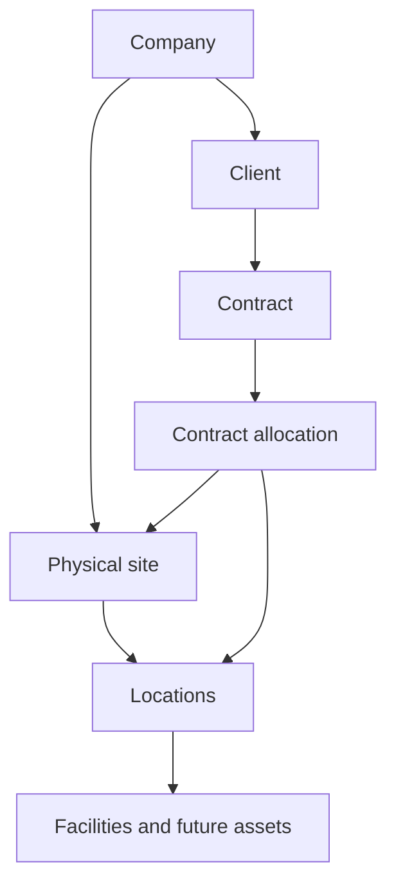

# Physical sites and contract allocations — correction review

Status: implementation on `feature/phase1-site-contract-decoupling`; verified in CI; awaiting architecture review. Phase 2 is paused. No merge, production rule/index deployment, billing change or live migration has been performed for this correction.

## Repository findings

The latest Phase 1 branch remains `4868de1d8a2ecdb64063772fdcbc2750e0510b1c`. Main contains its merge `1dd9a95b5c632da51dcab52bc4e200bdcd6e4773`; the trees match. Main CI 43543559087 and Pages 43543559134 passed. The preceding authorized Phase 1 rollout deployed its rules/indexes, and all 23 indexes subsequently reported READY.

Yesterday's correction branch had two additional commits: design `0922f21` and read-only audit `f497003`. No functional correction existed yet. The separate `feature/phase2-after-site-decoupling` head `1ac7e9d` adds release-gate documentation only. This work continues the existing dedicated correction branch from `f497003`, preserving those changes. Uncommitted Phase 2 implementation remains isolated in its original checkout and has not been merged into this correction.

## Corrected relationships



An allocation references a contract and a physical site, with an optional specific location. Its client snapshot is derived from the contract and validated by rules. Sites can exist before any clients or contracts. Assets and maintenance histories continue to belong to physical IDs; no Phase 2 module is introduced here.

## Screens and behavior

- Site create/edit has no Client or Contract selector. New sites use schema version 2 and omit both fields.
- Existing schema-1 sites remain readable/editable. The UI shows a migration notice and preserves their original client/contract fields invisibly; browser edits cannot remove/reassign those legacy links.
- Contract allocations are available under Companies & sites, inside site details, and under contract details. Client details show the client's contracts rather than directly owned sites.
- Allocation forms select a contract, site and optional space; the client is derived and displayed. Service coverage can cover an entire site without occupancy.
- Exclusive and shared occupancy require an exact location. Multiple contracts/clients can use different spaces in one site. Shared/shared dates may overlap; exclusive/shared and exclusive/exclusive overlaps are denied.
- Code, contract, client snapshot, site/location, allocation type and planned dates are immutable after creation. Replace an incorrect draft rather than rewriting its identity. Name/notes and valid lifecycle decisions remain editable.
- Lifecycle: draft → active or archived; active → terminated or expired; terminated/expired → archived. Closed allocations cannot reopen. Termination requires an inclusive effective end date inside the original interval; future dates after that day become available.
- Every saved allocation revision has a corresponding append-only history snapshot. The original client snapshot and planned interval survive expiry, termination, archive and later contract-client changes.

## Occupancy policy and bounded Spark implementation

`occupancyCalendars/{locationId}_{year}` is a transactionally read and written per-space/year registry. A new active occupancy appends exactly one reservation. Rules check overlap against all retained entries, bind the registry change to the matching allocation revision and require both writes atomically. Concurrent writers contend on this same document; a query-only availability check is never authoritative.

There are **at most 12 retained reservations per exact space per calendar year**, including closed historical reservations. Occupancy dates must fit one calendar year; split a multi-year tenancy into annual allocations. Service coverage has no calendar-year restriction and consumes no occupancy slot. Full calendars fail with a clear capacity message; increasing capacity requires a separately tested design change. There is no hidden fallback or insecure write path.

Shared occupancy is explicitly **unmetered shared use**, not a seat/bed-capacity system. The registry applies to the selected location ID, not recursively to a building and its descendants. Configure distinct rentable spaces as distinct location records; this phase does not promise hierarchical whole-building exclusivity. Both policies require business review before rollout.

Termination replaces only the matching reservation with a shortened interval. All other entries are retained exactly. Original booking intervals and termination decisions remain in allocation history. Active status is a lifecycle state; clock-driven expiry is not scheduled automatically on Spark. Expiry does not remove the reservation.

## Schema, rules and queries

- `sites`: schema 2 retains physical fields/IDs and metadata, without clientId/contractId. Legacy schema 1 readers/writers are compatible until trusted migration. New schema-1 sites are rejected.
- `contractAllocations`: Phase 1 metadata, code/name/notes/status, contractId/siteId/locationId, allocationType, inclusive startDate/endDate, effectiveEndDate, immutable clientIdSnapshot.
- `contractAllocations/{id}/history/{revision}`: companyId/revision/actorUid/occurredAt and validated snapshot. It is client-attributed operational history, not an independent compliance audit.
- `occupancyCalendars`: company/site/location/year, bounded slots, revision, witnessId and server update metadata. No client deletion or list access.
- `siteMigrations/{siteId}`: trusted-only migration checkpoint containing the full original site, source hash and approved plan. No browser write access.
- Active/draft allocations count references to their contract and to their location (or directly to the site for whole-site coverage). Existing physical parent chains protect sites transitively. Termination/expiry/archive releases active references while retaining history. Contract client/date changes are blocked while linked allocations remain active/draft.
- Original Phase 1 counters and four-ancestor location rule remain. All new operations require canonical active owner/admin membership; other tenants and staff receive no new authority.
- Seven allocation composite indexes support paginated name/status/contract/site/location queries. The 23 legacy indexes are retained for compatibility.

I've set up prototype Security Rules to keep the data in Firestore safe. They are designed to be secure for tenant-isolated allocations, derived client identity, atomic occupancy reservations, immutable history and protected reference counters. However, you should review and verify them before broadly sharing your app. If you'd like, I can help you harden these rules.

## Migration plan and dry-run evidence

The migration is a trusted local administrative operation, never a browser action or CI production deployment. It defaults to **dry-run**. See `scripts/migrate-site-contract-links.mjs` and `scripts/site-migration-plan.mjs`.

1. Export a backup in owner-controlled storage and pause legacy writers for the migration window.
2. Run the read-only audit/dry-run with explicit project/company and ADC credentials. Records are read in pages of 50.
3. Review each site. A client-only link can be detached only by explicit `detach_only` decision. A contract link requires explicit `draft_allocation` with reviewed service/shared/exclusive type and location. Missing/mismatched references remain unresolved; no occupancy is inferred from old ownership.
4. Save and approve the dry-run report. The plan hashes the source site and contract and uses deterministic allocation/code IDs. Apply requires the approved report and matching project confirmation. Changed plans are rejected.
5. Each site migration is one trusted transaction: preserve the complete original site in a checkpoint, create a reviewed **draft** allocation where appropriate, reconcile legacy/new counters, remove legacy pointers and promote the site schema. Existing allocation/code collisions without matching checkpoints abort. Unresolved rows are skipped and reported.
6. Replay sees schema-2/checkpointed sites and creates no duplicate allocations. Verify counts, counters, backups and application reads before enabling normal operation. Activate drafts separately through the tested occupancy path.
7. Rollback is a reviewed compensating procedure using originalSite backups. Do not overwrite a site/allocation that has changed after migration; pause writes, compare revisions, reverse only unchanged draft allocations and their counters, restore legacy links/metadata and retain the migration audit. No destructive automated rollback is supplied.

Example dry-run (replace company and local file paths):

```sh
node scripts/migrate-site-contract-links.mjs --project facilityos-43386 --company COMPANY_ID --decisions reviewed-decisions.json --report dry-run.json
```

Explicit apply, **only after separate approval and compatible rule/index deployment**:

```sh
node scripts/migrate-site-contract-links.mjs --project facilityos-43386 --company COMPANY_ID --decisions reviewed-decisions.json --report applied.json --apply --approved-report dry-run.json --confirm-project facilityos-43386
```

[Fixture dry-run report](evidence/correction/migration-dry-run.json) and [migration verification](evidence/correction/migration-results.json) use isolated demo data. The live read-only audit failed during credential/environment initialization (`uv_interface_addresses`); **no live dry-run report exists and no live migration ran**. A successful authorized live audit and review remain mandatory before production data changes. Do not treat the fixture report as evidence of current production relationships.

## Verification and remaining gates

- Local lint, formatting, strict TypeScript, all 24 unit tests and production build passed.
- Emulator regression suite: 40 passed, including direct forged-write checks. Tests include independent sites, legacy edit preservation, snapshots/history, tenant denial, archive/reference integrity, concurrent exclusive occupancy, shared occupancy, annual limits and lifecycle protection.
- Migration planner: seven cases passed. Emulator migration: seven checks passed (no-op dry-run, original backup, physical field preservation, reference detach/reconciliation, draft creation and idempotent replay).
- Browser script includes independent site creation before clients, service allocation, occupancy termination/history and desktop/tablet/mobile checks alongside the original flow. Local Chromium is unavailable; GitHub CI supplies the browser environment. CI passed all 11 browser checks with no page errors at 1440×1000, 768×1024 and 390×844. Desktop and mobile captures were visually reviewed.
- Existing JavaScript bundle-size warning remains (~978 KB before gzip).

Review gates: approve the exact-space/unmetered-shared/12-per-year policy; complete live audit and decisions; review rules and migration plan; authorize a coordinated compatible deployment and migration. Phase 2 remains paused until this correction is reviewed. Production and `https://fms.flowb.io/` remain unchanged by this branch.

## Verified delivery

Implementation commit: `3f17d1f717c1317088aa200269f9f3ee8d4e74a9`. [All CI checks passed](https://github.com/tsforcetech/FMS/actions/runs/43598720602): formatting, lint, strict typechecking, 24 unit tests, 40 security/regression tests, seven migration planner tests, seven emulator migration checks, production build and 11 browser checks. This final documentation/evidence commit does not change application code.

Browser evidence: [results](evidence/correction/browser-results.json), [desktop](evidence/correction/allocation-desktop.png), [tablet](evidence/correction/allocation-tablet.png), [mobile](evidence/correction/allocation-mobile.png). Captures and migration fixtures are isolated emulator data, not production data.
